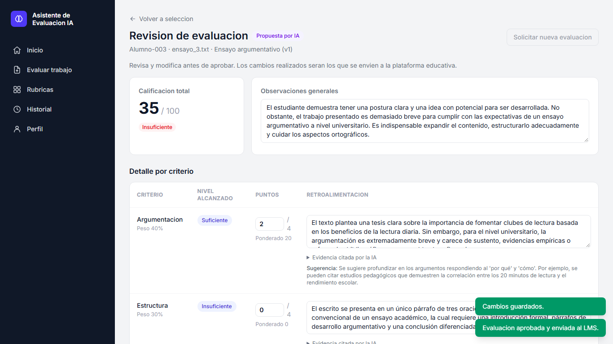
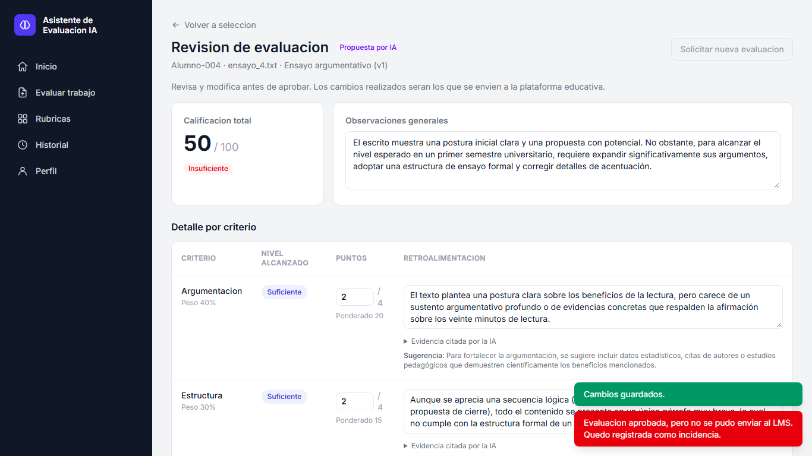
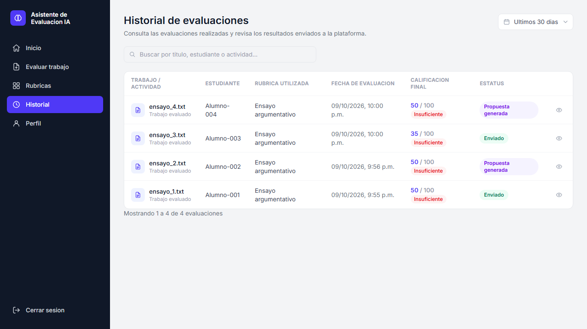
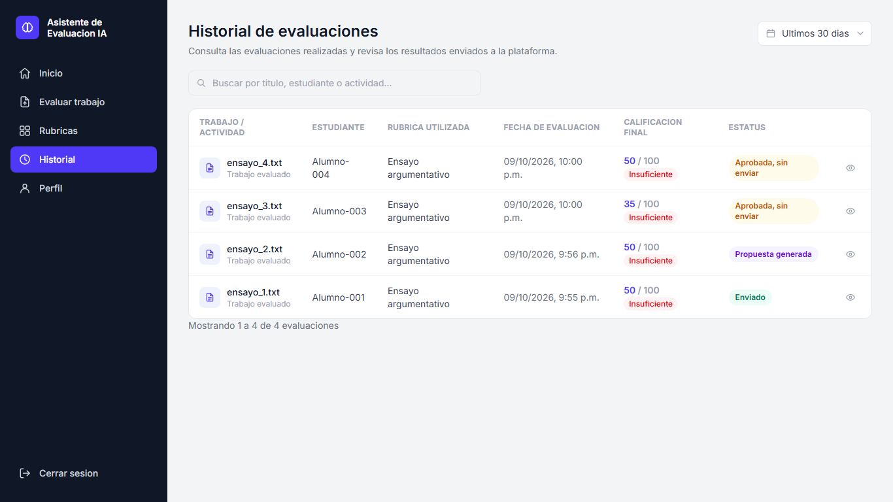

# RNF-07 — Evaluación heurística de la interfaz (Nielsen, 1994)

> **Elaborada con apoyo de IA; revisada y validada por los tesistas.**
>
> Validación: los tesistas revisaron los 13 hallazgos el 2026-10-09 y los confirmaron como correctos (columna "Validado por los tesistas").

| Dato | Valor |
|---|---|
| Fecha | 2026-10-09 |
| Método | Inspección de las 6 pantallas con las 10 heurísticas de Nielsen (1994), apoyada en las 18 capturas de RNF-06 y en la revisión del código del frontend para comportamientos que no se ven en una captura (botones sin acción, textos de notificaciones). |
| Pantallas | Inicio (`/`), Evaluar (`/evaluar`), Revisión (`/evaluaciones/:id/revision`), Rúbricas (`/rubricas`), Detalle de rúbrica (`/rubricas/:id`), Historial (`/historial`) |
| Apoyo visual | [`../RNF-06/antes/`](../RNF-06/antes/) y [`../RNF-06/despues/`](../RNF-06/despues/) |
| Limitación | Es una inspección experta, no una prueba con usuarios: no sustituye la evaluación con docentes (RF-11, RF-12 y RD-08 quedan fuera de este documento). |

## Escala de severidad (Nielsen)

| Valor | Significado |
|---|---|
| 0 | No es un problema de usabilidad |
| 1 | Cosmético: se corrige solo si sobra tiempo |
| 2 | Menor: prioridad baja |
| 3 | Mayor: importante corregirlo, prioridad alta |
| 4 | Catástrofe: imprescindible corregirlo antes de liberar |

## Heurísticas

H1 Visibilidad del estado del sistema · H2 Coincidencia entre el sistema y el mundo real · H3 Control y libertad del usuario · H4 Consistencia y estándares · H5 Prevención de errores · H6 Reconocer antes que recordar · H7 Flexibilidad y eficiencia de uso · H8 Diseño estético y minimalista · H9 Ayudar a reconocer, diagnosticar y recuperarse de errores · H10 Ayuda y documentación

## Hallazgos

| ID | Heurística | Pantalla(s) | Hallazgo | Severidad | Recomendación | Estado | Validado por los tesistas (Sí/No/Ajuste) |
|---|---|---|---|---|---|---|---|
| H1-01 | H1 | Revisión, Historial | Al aprobar, la notificación siempre dice "Evaluación aprobada y enviada al LMS" y el historial muestra "Enviado" para toda evaluación `APPROVED`, aunque el envío al LMS haya fallado (caso RI-07). El docente cree que la calificación llegó al LMS cuando no fue así. | **3** | Basar el mensaje y la etiqueta en `sent_to_lms_at`. | **Corregido** | Sí |
| H7-01 | H7 / H8 | Las 6 pantallas en 768 y 375 px | La barra lateral fija de 256 px y el contenido sin `min-w-0` provocaban desbordamiento horizontal de toda la página en tableta y móvil (11 de 18 combinaciones). | **3** | Barra superior por debajo de `lg` y `min-w-0` en `main`. | **Corregido** (ver RNF-06) | Sí |
| H2-01 | H2 | Revisión | La tarjeta "Generaciones de IA" muestra códigos internos (`HTTP_ERROR`, `VALID`) en lugar de lenguaje del docente. | 2 | Traducir a "Falló la conexión con la IA" / "Propuesta válida". | Pendiente | Sí |
| H3-01 | H3 | Todas (barra lateral) | El botón "Cerrar sesión" no tiene acción asociada. | 2 | Implementar el cierre (borrar el token de sesión LTI de `sessionStorage`) u ocultarlo mientras se use el token compartido. En móvil quedó oculto por el ajuste de RNF-06. | Pendiente | Sí |
| H5-01 | H5 | Evaluar | El marcador de posición del identificador del estudiante es "Nombre o matrícula", lo que invita a capturar nombres reales. | 2 | Sugerir un identificador seudónimo ("Matrícula o ID del LMS"). | Pendiente | Sí |
| H6-01 | H6 | Rúbricas | El listado no muestra el estado de cada rúbrica (borrador/publicada/archivada); el docente debe recordar cuáles puede usar en "Evaluar", donde solo aparecen las publicadas. | 2 | Añadir columna de estado con `StatusBadge`. | Pendiente | Sí |
| H7-02 | H7 | Revisión, Historial (375 px) | En móvil las tablas se desplazan horizontalmente dentro de su tarjeta; en la revisión, la retroalimentación editable queda fuera de la vista inicial. | 2 | Vista de tarjetas apiladas por criterio en pantallas pequeñas. | Pendiente | Sí |
| H9-01 | H9 | Todas | El mensaje para `UNAUTHORIZED` dice "Revisa el token configurado en el frontend"; con sesiones LTI que expiran a las 8 h, el docente no sabe que debe volver a entrar desde el LMS. | 2 | "Tu sesión expiró; vuelve a abrir el asistente desde Moodle". | Pendiente | Sí |
| H2-02 | H2 / H4 | Todas | Textos sin acentos ni signos de apertura ("Rubricas", "Evaluacion", "Bienvenido, Docente!"). | 1 | Revisión ortográfica de los textos de la interfaz. | Pendiente | Sí |
| H4-01 | H4 | Inicio, Evaluar | Icono de campana (notificaciones) que no hace nada. | 1 | Retirarlo o conectarlo a las incidencias. | Pendiente | Sí |
| H4-02 | H4 | Revisión, Detalle de rúbrica | Enlaces de regreso inconsistentes: "Volver a selección" (destino poco claro) frente a "Volver al listado". | 1 | Unificar como "Volver a …" con el nombre del destino. | Pendiente | Sí |
| H8-01 | H8 | Detalle de rúbrica | Las descripciones de los criterios se truncan sin forma de leerlas completas. | 1 | Ajuste de línea o `title` con el texto completo. | Pendiente | Sí |
| H10-01 | H10 | Todas | No hay ayuda contextual (qué hace "Solicitar nueva evaluación", cómo se ponderan los pesos). | 1 | Textos de ayuda breves o enlace al manual de usuario. | Pendiente | Sí |

### Aspectos positivos observados (severidad 0)

- **H5:** aprobar una evaluación y eliminar una rúbrica piden confirmación (`ConfirmDialog`).
- **H1:** durante la generación se muestra "Generando propuesta…" y un indicador de carga; "Continuar" queda deshabilitado mientras falten archivo o rúbrica.
- **H9:** los errores de la API se traducen a mensajes comprensibles (`ERROR_MESSAGES` en `ToastNotifications.tsx`).
- **H3:** antes de aprobar, el docente puede editar puntajes y retroalimentación, guardar o regenerar la propuesta.

## Correcciones de severidad 3 y 4 (antes y después)

No se encontraron hallazgos de severidad 4. Los dos de severidad 3 se corrigieron:

### H1-01 — Estado del envío al LMS

Escenario real (base `evidencias.db`): una integración LTI 1.3 activa sin `lineitem`, de modo que el envío falla y se registra `LMS_SEND_FAILED`. Se aprobó desde la interfaz con Playwright (`frontend/e2e/aprobar_y_capturar.mjs`): la evaluación 3 con el código anterior y la 4 con la corrección.

| | Antes | Después |
|---|---|---|
| Notificación |  "Evaluación aprobada y enviada al LMS." (falso) |  "Evaluación aprobada, pero no se pudo enviar al LMS. Quedó registrada como incidencia." |
| Historial |  "Enviado" |  "Aprobada, sin enviar" (ámbar); "Enviado" solo si existe `sent_to_lms_at` |

Archivos: `frontend/src/pages/ReviewEvaluationPage.tsx`, `frontend/src/components/StatusBadge.tsx`, `frontend/src/components/HistoryTable.tsx`.

### H7-01 — Desbordamiento horizontal

Antes: 7/18 combinaciones sin desbordamiento. Después: 18/18. Detalle, capturas y causa en [`../RNF-06/README.md`](../RNF-06/README.md). Archivo: `frontend/src/layouts/AppLayout.tsx`.

## Referencia

Nielsen, J. (1994). *Usability Engineering*. Morgan Kaufmann. Nielsen, J. (1994). Enhancing the explanatory power of usability heuristics. *Proceedings of the SIGCHI Conference on Human Factors in Computing Systems*, 152–158.
